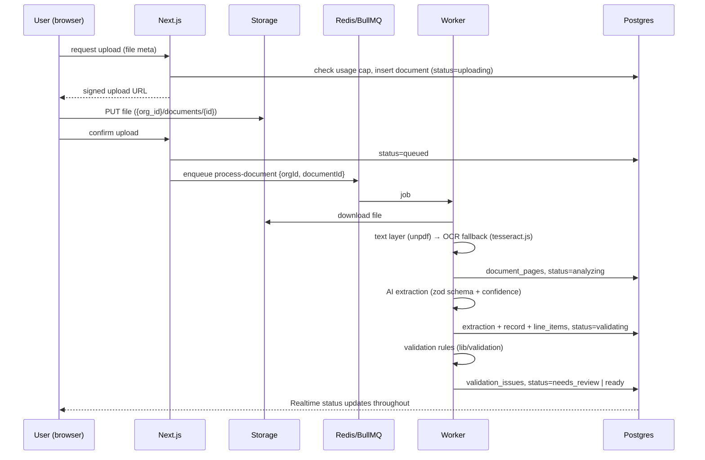

# Architecture

## Overview

```
 Browser ──► Next.js (Vercel) ──────────────► Supabase Postgres (RLS)
   │            │  Server Components            ▲        ▲
   │            │  Server Actions               │        │ service role, org-scoped
   │            │  Route Handlers (webhooks,    │        │
   │            │   downloads)                  │        │
   │            └──► enqueue() ──► Redis ──► Worker (Railway/Fly, Docker)
   │                            (BullMQ)         │  text extraction, OCR, AI, validation,
   │                                             │  PDF rendering (Playwright), ZIP
   ├── direct upload (signed URL) ──► Supabase Storage ◄──┘
   └── Realtime subscription ◄── Supabase Realtime (documents.status)
```

| Concern       | Choice                                                                      |
| ------------- | --------------------------------------------------------------------------- |
| Web           | Next.js 15 App Router at repo root, deployed on Vercel                      |
| Backend logic | Server Actions (mutations), Route Handlers (webhooks, file downloads)       |
| Long work     | Node worker in `worker/` (BullMQ), Docker image on Railway or Fly.io        |
| Queue         | Redis (Upstash in prod, Docker locally)                                     |
| DB / Auth     | Supabase Postgres + Supabase Auth via `@supabase/ssr`                       |
| Files         | Supabase Storage (S3-compatible); private buckets; signed URLs              |
| Live status   | Supabase Realtime on `documents` (RLS-filtered)                             |
| AI            | Vercel AI SDK, provider set by `AI_PROVIDER`/`AI_MODEL` (`lib/ai/provider`) |
| PDF           | HTML templates → Playwright Chromium `page.pdf()` in the worker             |
| Payments      | Stripe Checkout + Customer Portal + webhook                                 |

No separate Node API server: Next.js covers request/response work; the worker covers everything long-running
(see ADR-002).

## Shared code

`lib/` is framework-agnostic and imported by both the web app and the worker via the `@/` alias. Rules:

- `lib/` must not import from `app/`, `components/` or `features/`.
- Code that needs Next.js request context (`cookies()`) lives in `lib/supabase/server.ts` only and is marked
  `server-only`.
- The worker never imports React components except `pdf/` templates (rendered to static HTML).

## Document processing pipeline



Details: [DOCUMENT_PIPELINE.md](DOCUMENT_PIPELINE.md).

## Queues

| Queue              | Payload                 | Purpose                                |
| ------------------ | ----------------------- | -------------------------------------- |
| `health`           | `{ sentAt }`            | Liveness / `npm run queue:ping`        |
| `process-document` | `{ orgId, documentId }` | Extract → OCR → AI → validate → route  |
| `render-report`    | `{ orgId, reportId }`   | Render one PDF, upload, mark ready     |
| `batch-zip`        | `{ orgId, batchId }`    | Wait for child reports, zip, upload    |
| `import-csv`       | `{ orgId, importId }`   | Parse, validate, insert, report errors |

Payload schemas live in `lib/queue/jobs.ts`; always enqueue via `enqueue()` (validates first). Jobs must be
**idempotent** (safe to retry): use upserts keyed by document/report id, and check current status before acting.
Default: 3 attempts, exponential backoff from 5s.

## PDF rendering

- Templates are React components in `pdf/templates/*` composed from `pdf/components/*`, rendered to static HTML with
  `renderToStaticMarkup`, plus a print stylesheet (`pdf/styles/print.css`).
- Playwright `page.pdf({ format: "A4", displayHeaderFooter: true, headerTemplate, footerTemplate })` provides the
  logo/header and "Page X of Y" via `pageNumber`/`totalPages`.
- Tables: `thead { display: table-header-group }`, `tfoot { display: table-footer-group }`,
  `tr { break-inside: avoid }`; section headings use `break-after: avoid`.
- All figures come from `lib/calc` — templates only format.
- One browser instance per worker process, one context per job.

## Deployment

| Piece    | Where             | Notes                                                  |
| -------- | ----------------- | ------------------------------------------------------ |
| Web      | Vercel            | Env from Vercel project settings                       |
| Worker   | Railway or Fly.io | `worker/Dockerfile` (Playwright base image), ≥1 GB RAM |
| Redis    | Upstash           | TLS URL (`rediss://`) in `REDIS_URL`                   |
| Database | Supabase cloud    | Migrations applied via `supabase db push` in CI        |

Local: `docker compose up -d redis`, `npx supabase start`, `npm run dev`, `npm run worker:dev`.

## Observability (Phase 11)

Structured JSON logs (worker `logger`), Sentry for web + worker, BullMQ job metrics, and a `/api/health` endpoint.
